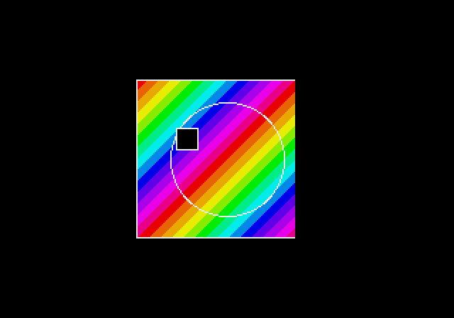

# LFB : Linear Frame Buffer sur Mega Drive

Un frame buffer **linéaire** de 128×112 en 4bpp sur Sega Mega Drive / Genesis. Le 68k dessine avec
`offset = y*64 + x/2`, le buffer part tel quel en VRAM par DMA, et le VDP l'affiche correctement
grâce au VScroll par colonne (mode 2-cell) et à une H_INT par ligne.



Explications détaillées (enjeux, principe, décisions, état des lieux, pistes) :
[docs/fiche-recapitulative.md](docs/fiche-recapitulative.md)

## En bref

- Chaque ligne du buffer occupe 2 tiles (64 octets). Le groupe de 8 px `k` correspond à la rangée `k&7` du tile `400+2y+(k>>3)`.
- Les groupes pairs sont sur le plan A, les impairs sur le plan B. La VSRAM par colonne vaut A = `2m&7`, B = `(2m+1)&7`, plus une base qui avance de **+7** à chaque ligne.
- L'H_INT réécrit la VSRAM à chaque ligne à partir d'une table précalculée. Le vecteur pointe vers un `jmp` en RAM.
- Après la dernière ligne, l'affichage est coupé et le DMA de 7168 octets tourne à pleine vitesse.

## ROMs

| Fichier | Largeur visible | Mots VSRAM / ligne | Genesis Plus GX |
|---|---|---|---|
| `roms/lfb_96px.bin`  | 96 px  | 12 | OK |
| `roms/lfb_112px.bin` | 112 px | 14 | OK, à la limite |
| `roms/lfb_128px.bin` | 128 px | 16 | échec : H_INT perdues |

Le buffer en RAM fait toujours 128×112 ; seule la fenêtre affichée change. Aucune de ces ROMs n'a encore été testée sur vraie console.

## Construire

Prérequis : binutils m68k (`apt install binutils-m68k-linux-gnu`, ou l'équivalent Homebrew) et python3.

```sh
./build.sh                  # 112 px -> roms/lfb.bin
VIS_COLS=6 ./build.sh       # 96 px
VIS_COLS=8 ./build.sh       # 128 px
```

## Tester sous émulateur

```sh
pip install stable-retro pillow numpy
python3 tools/test_emu.py roms/lfb.bin --vis-cols 7 --png capture.png
```

Le script lance la ROM dans Genesis Plus GX, vérifie les lignes affichées et compare chaque groupe
de 8 pixels au buffer attendu. Le carré mobile, absent de l'image de référence, produit 32 à 48
différences regroupées sur 16 lignes : c'est normal.

## Arborescence

```
src/lfb.s             source 68k (GNU as, --register-prefix-optional)
tools/gen_data.py     tables VSRAM, tilemaps, image de fond, palette, config.inc
tools/test_emu.py     test automatique sous émulateur
build.sh              construction + checksum de l'en-tête
roms/                 ROMs précompilées
docs/                 fiche récapitulative, capture
```
